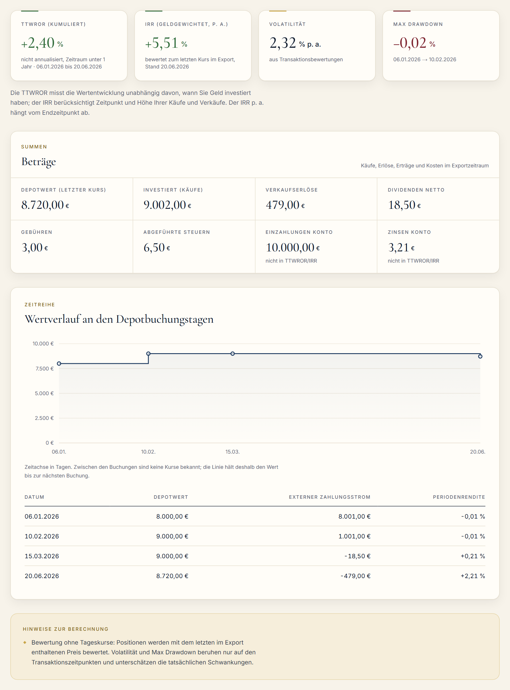

# DepotDoktor

Clientseitiger Depot-Steuer- und Performance-Analyzer für deutsche Broker-Exporte. CSV rein, Report raus. Keine Anmeldung, keine Speicherung, keine Übertragung Ihrer Daten.

[](https://github.com/mirkan-morgenfels-ai/depotdoktor/actions/workflows/ci.yml)
[](./LICENSE)

Live-Demo: https://depotdoktor.vercel.app/projects/depotdoktor

**English summary.** DepotDoktor is a browser-only portfolio analyzer for German brokerage CSV exports (Trade Republic and Scalable Capital, more planned). It computes the time-weighted return (TTWROR), the money-weighted return (IRR via Newton's method), volatility, maximum drawdown and asset allocation, and it estimates German fund taxation (Vorabpauschale, Teilfreistellung, FIFO). All computation runs client-side; no file content leaves the browser. Parsers are tested on synthetic fixtures; verification against real broker exports is pending. Built with Next.js and TypeScript, tested with Vitest and Playwright.

## Ziel

Ziel: TTWROR und IRR getrennt ausweisen und die Vorabpauschale nachvollziehbar schätzen, direkt aus dem Broker-Export, im Browser, ohne Konto und ohne Datenübertragung.

## Was DepotDoktor macht

- Liest den Transaktionsexport von Trade Republic und die Transaktionen-CSV von Scalable Capital ein und erkennt das Format an der Kopfzeile.
- Berechnet TTWROR, IRR, Volatilität (annualisiert) und Max Drawdown aus den Depotbuchungen.
- Zeigt die Allokation nach Assetklasse und Region; Region ist der Ländercode der ISIN, also das Fondsdomizil, nicht die Anlageregion.
- Schätzt die Vorabpauschale je Position nach § 18 InvStG mit Teilfreistellung und FIFO bei Verkäufen. Bei Kauf im Jahr wird die Vorabpauschale um 1/12 je vollen Monat vor dem Kaufmonat gekürzt (§ 18 Abs. 2 InvStG).
- Exportiert den Report als PDF und die normalisierten Transaktionen als CSV für ein deutsches Excel (Abschnitt „CSV-Export“).
- Verarbeitet alles im Browser. Es gibt keinen Upload, keinen Account und keine Speicherung. Eine Content-Security-Policy (`default-src 'self'`, `connect-src 'self' data:`, `form-action 'self'`) verhindert technisch, dass Skripte der Seite Daten per fetch oder XHR, als Bild-, Skript- oder Formularanfrage an fremde Server senden. Fremde Seiten werden nur aufgerufen, wenn Sie einen externen Link anklicken.

## Status

Stand 20.10.2026: Version 1 ist umgesetzt und live (siehe „Roadmap“). Geprüft sind die Parser an synthetischen Testdateien sowie Kennzahlen und Steuerlogik an Handrechnungen und an den Rechenbeispielen des BMF (siehe „Tests“). Offen ist die Prüfung an echten Exporten von Trade Republic und Scalable Capital, die die Daten des Autors braucht; Anleitung, Prüfliste und Prüfprotokoll dafür stehen in [docs/pruefung-echte-exporte.md](docs/pruefung-echte-exporte.md). Ebenfalls offen ist der Abgleich mit dem Vorabpauschale-Rechner der Stiftung Warentest ([docs/verifikation.md](docs/verifikation.md)).

## Screenshots




Beide Ansichten zeigen die Beispieldatei, also die synthetische Trade-Republic-Testdatei aus [`packages/csv/fixtures/`](packages/csv/fixtures/). Im Steuerreiter sind für den ETF Beispielkurse eingetragen (Kurs 01.01.2026: 80,00 €, Kurs 31.12.2026: 95,00 €); sie stammen nicht aus dem Export. Aufgenommen mit dem Datum 08.10.2026, deshalb weist der Steuerreiter darauf hin, dass das Steuerjahr 2026 noch läuft.

## So funktioniert es

```
CSV-Datei (Browser)
  -> Papa Parse
  -> Broker-Erkennung (Header-Signatur)
  -> Normalisierung (Datum, Dezimaltrenner, Vorzeichen, Encoding)
  -> Transaktionsmodell (Buy / Sell / Dividend / Fee / Tax)
  -> Rechenmodul (TTWROR, IRR, Volatilität, MDD, Allokation, Steuer)
  -> Report-Ansicht (Recharts) + Export (@react-pdf/renderer, CSV)
```

## Unterstützte Exporte

| Anbieter | Status | Format |
|---|---|---|
| Trade Republic (Transaktionsexport aus der App) | unterstützt (Format nach öffentlicher Beschreibung, Abgleich mit echtem Export offen; Spalten nach `tax` angenommen) | 23 Spalten, Komma, alle Felder in Anführungszeichen, Dezimalpunkt, ISO-Datum, UTF-8 |
| Scalable Capital (Broker → Transaktionen → CSV) | unterstützt (Format nach öffentlicher Beschreibung, Abgleich mit echtem Export offen) | 14 Spalten, Semikolon, Dezimalkomma, ISO-Datum, UTF-8 |
| DKB, ING, comdirect (Depot-Exporte) | geplant | Formate werden an echten Dateien verifiziert |
| Trade Republic PDF-Abrechnungen | geplant | Fallback für ältere Zeiträume |

Testdateien für jeden unterstützten Anbieter liegen unter [`packages/csv/fixtures/`](packages/csv/fixtures/). Sie sind synthetisch und enthalten keine echten Daten.

Den CSV-Export der Transaktionen bietet Scalable Capital laut eigener FAQ nur im PRIME+ Broker an, nicht im FREE Broker (Stand 20.10.2026). Exportwege beider Broker mit Quellen stehen in [docs/pruefung-echte-exporte.md](docs/pruefung-echte-exporte.md).

## Kennzahlen und Steuerlogik

- Bewertungspunkte: nur Depotbuchungen, also Kauf, Verkauf, Ausschüttung sowie Gebühren, Steuern und Einbuchungen mit ISIN. Einzahlungen, Auszahlungen, Zinsen und Kartenzahlungen des Verrechnungskontos bestimmen weder den Zeitraum noch die Bewertungspunkte; sie erscheinen nur als Kontokennzahlen. Der Zeitraum reicht vom ersten Kauf bis zur letzten Depotbuchung.
- TTWROR: Verkettung der Periodenrenditen zwischen den Depotbuchungen, sodass Käufe und Verkäufe die Rendite nicht verzerren. Zuflüsse in ein leeres Depot (erster Kauf, Kauf nach Vollverkauf) werden zu Periodenbeginn angesetzt; auch die Gebühr des ersten Kaufs mindert die TTWROR. Unter einem Jahr wird die TTWROR kumuliert und nicht annualisiert ausgewiesen, ab einem Jahr p. a.
- IRR: Nullstelle des Kapitalwerts per Newton-Verfahren, Bisektion als Fallback, wenn Newton nicht konvergiert. Der offene Bestand wird zum letzten Kurs im Export am Tag der letzten Depotbuchung bewertet; der IRR p. a. hängt deshalb vom Endzeitpunkt ab.
- Volatilität: Standardabweichung der Periodenrenditen zwischen den Buchungstagen, auf Tagesbasis normiert und annualisiert mit √252. Ohne Tageskurse unterschätzt sie die tatsächliche Schwankung; die Oberfläche weist darauf hin.
- Max Drawdown: größter Rückgang vom laufenden Höchststand des zeitgewichteten Index, also derselben Verkettung wie bei der TTWROR. Nach einem Vollverkauf läuft der Index weiter; Zeiten ohne Bestand zählen mit 0 %, sodass ein Neukauf keinen künstlichen Rückgang erzeugt. Liegt der größte Rückgang am Kauftag selbst (Wert nach dem Kauf unter dem gezahlten Betrag, meist wegen der Kaufkosten), nennt der Hinweis nur dieses Datum („am <Datum> (Kauftag)“).
- Vorabpauschale: Basisertrag = Wert am 01.01. × Basiszins × 0,7. Vorabpauschale = Basisertrag abzüglich der Ausschüttungen des Jahres, höchstens der Wertzuwachs des Jahres, nie unter 0. Ausschüttungen zählen brutto, also einschließlich des Steuerabzugs (§ 2 Abs. 11 InvStG), und je Anteil nur für die Anteile, die am Zahltag im Bestand waren; später gekaufte Anteile mindern sie nicht (zu verifizieren, siehe [docs/verifikation.md](docs/verifikation.md)). Ohne Bestand am 31.12. fällt keine Vorabpauschale an; solche Positionen brauchen keine Kurse. Bei Kauf im Jahr wird die Vorabpauschale um 1/12 je vollen Monat vor dem Kaufmonat gekürzt (§ 18 Abs. 2 InvStG). Basiszins 2026: 3,20 % (BMF-Schreiben vom 13.01.2026), 2025: 2,53 %. Teilfreistellung 30 % (Aktienfonds), 15 % (Mischfonds), 60 % bzw. 80 % (Immobilienfonds). Steuersatz 26,375 % (25 % Kapitalertragsteuer plus Solidaritätszuschlag). Kirchensteuer, Sparerpauschbetrag (1.000 € bzw. 2.000 €) und Verlusttöpfe sind in v1 nicht berücksichtigt; die Oberfläche sagt das.
- FIFO: Bei Verkäufen gelten die zuerst gekauften Anteile als zuerst verkauft. Der Erlös zählt vor Steuerabzug, also Betrag der Buchung plus abgeführte Steuer; die Gebühr ist im Betrag bereits abgezogen. Werden Fondsanteile aus einem Vorjahr verkauft, kann im Steuerreiter der Betrag der bereits angesetzten Vorabpauschalen eingetragen werden; er mindert den Veräußerungsgewinn in voller Höhe (§ 19 Abs. 1 Satz 3 und 4 InvStG). Ohne Eingabe wird nichts abgezogen.

Rechenbeispiele: 10.000 € in einem thesaurierenden Aktien-ETF am 1. Januar 2026, Wertzuwachs 1.500 € im Jahr. Basisertrag 224,00 €, nach Teilfreistellung 156,80 € steuerpflichtig, Steuer 41,36 €. Mit 100 € Ausschüttungen und 150 € Wertzuwachs: 224,00 − 100,00 = 124,00 €, der Wertzuwachs von 150 € deckelt nicht, Vorabpauschale 124,00 €.

Amtliches Beispiel (BMF-Schreiben vom 21.05.2019 zu Anwendungsfragen des InvStG, Rz. 18.3 und 18.11): Rücknahmepreis 100 € am Jahresanfang und 100,50 € am Jahresende, Ausschüttung 0,10 € je Anteil, Basiszins 1,0 %. Basisertrag 100 × 1,0 % × 0,7 = 0,70 €, begrenzt auf den Mehrbetrag 0,50 + 0,10 = 0,60 €, abzüglich der Ausschüttung bleibt eine Vorabpauschale von 0,50 €. Bei Erwerb am 10. Juli mindert sie sich um 6/12 auf 0,25 €. DepotDoktor kommt in beiden Fällen auf dieselben Werte (Unit-Tests, siehe [docs/verifikation.md](docs/verifikation.md)).

Der Fondstyp (und damit die Teilfreistellungsquote) wird je Position vom Nutzer gewählt und gilt für alle Steuerjahre. Vorbelegt ist „Aktienfonds“, bei Aktien, Anleihen und Krypto „kein Fonds“. Nennt der Export keine Assetklasse (im Scalable-Export bei allen Wertpapieren), ist nichts vorbelegt: Das Auswahlfeld zeigt „Bitte wählen“, und Steuerkacheln und PDF zeigen „–“ mit „Fondstyp wählen“, bis Sie einen Fondstyp wählen, denn eine falsche Teilfreistellung (§ 20 InvStG) verfälscht die Steuer. Positionen ohne Bestand am 31.12. brauchen keine Wahl. Werden Anteile aus Vorjahren verkauft, erscheint das Feld für bereits angesetzte Vorabpauschalen erst nach der Wahl eines Fondstyps; bis dahin steht am Verkauf ein Hinweis mit der Sprungmarke „Zum Fondstyp“. Eine freie, weiterverbreitbare Datenquelle für die Teilfreistellungsquote je ISIN gibt es nicht. Die Kurse am 01.01. und 31.12. werden je Steuerjahr und Position eingetragen. Vorbelegt ist für den 01.01. der letzte Kurs aus dem Export bis zum 31.12. des Vorjahres, für den 31.12. der letzte Kurs bis zum Ende des Steuerjahres; diese Werte sind als „vorläufig“ gekennzeichnet. Fehlt ein Kurs oder stammen beide unverändert aus derselben Buchung, zeigt DepotDoktor kein Steuerergebnis, sondern „Kurse eintragen“. Beim Wechsel des Steuerjahres erscheinen die Kurse des gewählten Jahres, und der PDF-Report verwendet sie.

Vorbelegtes Steuerjahr: das letzte abgeschlossene Kalenderjahr, an dessen Ende (31.12.) Wertpapiere im Bestand waren, denn für ein abgeschlossenes Jahr steht der Kurs am 31.12. fest und die Bank hat die Vorabpauschale bereits abgerechnet oder rechnet sie gerade ab. Gibt es kein solches Jahr, etwa weil alle Käufe im laufenden Jahr liegen, ist es das Jahr der letzten Depotbuchung; vorbelegte Kurse sind dann wie oben als „vorläufig“ gekennzeichnet. Für ein laufendes Jahr sagt der Steuerreiter, dass der Kurs am 31.12. noch nicht feststeht und die Vorabpauschale eine Vorschau ist; im PDF steht an der Kachel „Steuerjahr läuft noch“. Wählbar sind nur Jahre mit hinterlegtem Basiszins (2025 und 2026). Am 08.10.2026 ergibt die Beispieldatei 2026, eine Datei mit Bestand am 31.12.2025 ergibt 2025.

## CSV-Export

„Transaktionen als CSV“ richtet sich an Privatanleger, die die Datei per Doppelklick in einem Excel mit deutschen Ländereinstellungen öffnen. Wer die Rohdaten maschinell weiterverarbeiten will, nutzt den Original-Export des Brokers.

- Semikolon als Trennzeichen, Zeilenende CRLF, UTF-8 mit BOM (Excel liest Umlaute dann richtig).
- Spalten: Datum, Zeitstempel laut Export, Broker, Art, ISIN, Name, Kürzel, Assetklasse, Stück, Kurs, Betrag, Gebühr, Steuer, Währung, Buchungsart laut Export, Zeile im Export.
- Datum als TT.MM.JJJJ. Zahlen mit Dezimalkomma ohne Tausenderpunkt und in der vollen Genauigkeit der eingelesenen Daten, ohne zusätzliche Rundung. Das Minus ist ein ASCII-Bindestrich, kein typografisches Minuszeichen, damit Excel mit den Werten rechnet.
- Felder mit Semikolon, Anführungszeichen oder Zeilenumbruch stehen in Anführungszeichen; Anführungszeichen im Feld werden verdoppelt.
- Schutz vor Formel-Injektion: Textfelder, die mit `=`, `+`, `-`, `@`, Tab oder Wagenrücklauf beginnen, erhalten ein vorangestelltes Apostroph; Excel zeigt es in der Zelle an. Zahlenfelder bleiben unverändert.

Geprüft mit Unit- und E2E-Tests (Papa Parse zerlegt die Datei in 16 Spalten) und einmalig lokal in Excel 16 mit deutschen Ländereinstellungen: Datum und Beträge kommen als Zahlen an, die Summe der Beträge stimmt. Einzelheiten in [docs/verifikation.md](docs/verifikation.md). DepotDoktor selbst liest die exportierte Datei nicht wieder ein; sie ist kein Broker-Export und wird mit der Meldung „Das CSV-Format wurde nicht erkannt …“ abgelehnt.

## Datenschutz

Die CSV-Datei wird ausschließlich im Browser gelesen und verarbeitet. Inhalte Ihrer Datei werden nicht an einen Server übertragen, es gibt keine Anmeldung und keine Speicherung, weder auf dem Server noch im Browser (keine Cookies, kein localStorage). Beim Wechsel zwischen Seiten und beim ersten PDF-Export lädt der Browser Programmteile (JavaScript und Seitendaten) vom selben Server nach; diese Anfragen enthalten keine Daten aus der Datei. Ein automatisierter Test lädt die Beispieldatei, wechselt die Reiter, exportiert CSV und PDF und lässt dabei nur GET-Anfragen an denselben Server auf `/_next/static/` oder mit `_rsc`-Parameter zu. Es läuft keine Seitenstatistik.

## Tech-Stack

Next.js 16 (App Router, Turbopack), TypeScript 6.0 (strict), Tailwind CSS 4, Papa Parse, Recharts, @react-pdf/renderer, decimal.js für Geldbeträge, ESLint 10, Vitest 5, Playwright, pnpm Workspaces, GitHub Actions, Vercel. TypeScript 7 ist noch nicht im Einsatz, weil typescript-eslint es nicht unterstützt (Einzelheiten in [docs/verifikation.md](docs/verifikation.md), Abschnitt „Framework-Migration 17.10.2026“).

## Lokale Ausführung

Voraussetzungen: Node.js `^22.13.0`, `^24.0.0` oder `>=26.0.0`, pnpm 10 (Version über `packageManager` festgelegt, z. B. mit `corepack enable`).

```bash
git clone https://github.com/mirkan-morgenfels-ai/depotdoktor.git
cd depotdoktor
pnpm install
pnpm --filter web dev
```

Danach ist die Seite unter http://localhost:3000/projects/depotdoktor erreichbar. Umgebungsvariablen sind nicht nötig; `NEXT_PUBLIC_SITE_URL` überschreibt bei Bedarf die öffentliche Adresse für Metadaten (Standard: https://depotdoktor.vercel.app).

## Tests

```bash
pnpm test
pnpm test:e2e
```

`pnpm test` führt die Unit-Tests in `packages/csv`, `packages/pdf` und `apps/web` aus. `pnpm test:e2e` startet den Dev-Server (mit `CI=true` nach `pnpm build` den Produktionsserver, wie in der CI) und lädt die Testdateien im Browser. Der Port ist 3000, über `PORT` wählbar (z. B. `PORT=3101`); ohne installierte Playwright-Browser kann ein vorhandenes Chromium über `PLAYWRIGHT_CHROMIUM_PATH=/pfad/zu/chromium` angegeben werden.

Stand 20.10.2026 (zuletzt geprüft; Zahlen unverändert seit der Umstellung auf Next.js 16, ESLint 10 und Vitest 5 am 17.10.2026): 279 Unit-Tests (csv 50, pdf 2, web 227) und 29 Playwright-Tests, alle grün. Der frühere offene Test (`todo`) für Fall D ist seit 08.10.2026 ein echter Test gegen das BMF-Beispiel Rz. 18.11, siehe [docs/verifikation.md](docs/verifikation.md).

Unit-Tests decken TTWROR (auch mit Kaufgebühr des ersten Kaufs und Kauf nach Vollverkauf), IRR (einschließlich Divergenz-Fallback), Volatilität, Max Drawdown (auch nach Vollverkauf), die Bewertungspunkte an Depotbuchungen, Vorabpauschale (Normalfall, Wertzuwachs unter Basisertrag, Verlustjahr, unterjähriger Kauf mit Zwölftelung der Vorabpauschale, Bruttoausschüttungen je Anteil zum Zahltag, kein Bestand am 31.12.), die Rechenbeispiele des BMF-Schreibens vom 21.05.2019 (Rz. 18.3, 18.4 und 18.11), die Vorbelegung des Steuerjahres, Positionen ohne Assetklasse („Fondstyp wählen“), die Kursvorbelegung je Steuerjahr mit „vorläufig“ und „Kurse eintragen“, FIFO mit angesetzten Vorabpauschalen und mit Steuerabzug beim Verkauf, Kurseingaben je Steuerjahr mit Fondstyp je Position, die Dateityp-Erkennung (PDF, ZIP, Binärdaten, Windows-1252, UTF-16 mit BOM), den CSV-Export (BOM, CRLF, Quoting, Dezimalkomma, Vorzeichen, Injektionsschutz, Rücklesen mit Papa Parse) und den PDF-Report (zwölf Kennzahlen, übersprungene Zeilen, Hinweise, Fußzeile, Disclaimer auf jeder Seite) ab, jeweils mit von Hand gerechneten Erwartungswerten. Die E2E-Tests laufen mit fest eingestelltem Datum (08.10.2026), laden die Testdateien beider Broker hoch, auch als UTF-16-Datei, prüfen Kennzahlen und Diagramme in allen Reitern, das vorbelegte Steuerjahr, die Fondstypwahl bei Positionen ohne Assetklasse (Name, Beschreibung, `aria-invalid`), die Eingabe angesetzter Vorabpauschalen beim Verkauf (ohne gewählten Fondstyp den Hinweis mit „Zum Fondstyp“), den Wechsel des Steuerjahres mit Kursen je Jahr, den PDF- und CSV-Download (CSV mit BOM, CRLF und 16 Spalten je Zeile), die Fehlermeldung bei unbekanntem Format, die Ablehnung von PDF- und Excel-Dateien, Startseite, Navigation, Rechtsseiten, 404-Seite, Metadaten, `robots.txt` und Sitemap, die mobile Darstellung, axe-core bei 390, 768 und 1280 px und dass während der Auswertung keine Anfrage mit Dateiinhalten die Seite verlässt.

Die Steuerlogik ist gegen fünf von Hand durchgerechnete Referenzfälle (A–E, Tabelle in [docs/verifikation.md](docs/verifikation.md)) und seit 08.10.2026 gegen die amtlichen Rechenbeispiele des BMF-Schreibens vom 21.05.2019 (Rz. 18.3, 18.4 und 18.11) getestet; die Basiszinsen 2025 und 2026 sind gegen die BMF-Schreiben geprüft. Prüfung gegen einen externen Rechner: offen. Der Vorabpauschale-Rechner der Stiftung Warentest und ein Finanztip-Beispiel sind noch nicht abgeglichen, ebenso echte Broker-Exporte; offene Punkte und Abweichungen sind dort dokumentiert.

Die CI führt bei jedem Push auf main und bei jedem Pull Request `install → typecheck → lint → test → build` aus und anschließend die Playwright-Tests gegen den gebauten Stand.

## Projektstruktur

```
apps/web/app/projects/depotdoktor/    Seite
apps/web/components/depotdoktor/      Upload, Reiter Performance, Allokation, Steuer, Transaktionen
apps/web/lib/depotdoktor/             Bewertung, Kennzahlen (metrics/), Steuerlogik (tax/)
apps/web/lib/depotdoktor/__tests__/   Unit-Tests mit Handrechnungen
apps/web/lib/site.ts                  Projekte, Navigation, Live-Adressen
apps/web/e2e/                         Playwright-Tests
packages/csv/                         Parser, Broker-Erkennung, Normalisierung, Fixtures
packages/ui/                          Basiskomponenten
packages/legal/                       Disclaimer, Datenschutztexte
packages/charts/                      Diagramm-Komponenten (Recharts)
packages/pdf/                         Report-Vorlage für den PDF-Export (@react-pdf/renderer)
docs/verifikation.md                  Prüfstand der Steuerlogik, offene Punkte, Abweichungen
docs/pruefung-echte-exporte.md        Anleitung für die Prüfung an echten Broker-Exporten
CLAUDE.md                             Arbeitsanweisungen für die KI-gestützte Entwicklung mit Claude Code
```

## Grenzen

- Keine Live-Kurse. Offene Positionen werden mit dem letzten Preis aus dem Export bewertet.
- Der Fondstyp wird manuell gewählt; eine falsche Wahl ergibt eine falsche Teilfreistellung. Bei ETF und Fonds ist „Aktienfonds“ vorbelegt, auch wenn es sich um einen Renten- oder Mischfonds handelt; bitte prüfen.
- Steuerergebnisse sind Schätzungen. Maßgeblich ist die Abrechnung der depotführenden Bank, die zusätzlich Freistellungsaufträge, Verlusttöpfe und Kirchensteuer berücksichtigt.
- Ändert ein Broker sein Exportformat, bricht der Parser mit einer Fehlermeldung ab, statt falsche Zahlen zu liefern.
- Nur CSV-Dateien werden gelesen, als UTF-8, Windows-1252 oder UTF-16 mit BOM. PDF-Kontoauszüge, Excel- und ZIP-Dateien werden an der Dateisignatur erkannt und mit einem Hinweis auf den richtigen Export abgelehnt.
- Geprüft sind die Parser an synthetischen Testdateien, die den öffentlich beschriebenen Formaten nachgebaut sind; ein Abgleich mit echten Exporten steht aus ([docs/verifikation.md](docs/verifikation.md), Anleitung in [docs/pruefung-echte-exporte.md](docs/pruefung-echte-exporte.md)).

## Roadmap

- v1: Trade Republic und Scalable Capital, Kennzahlen, Vorabpauschale, PDF-Export. Stand 07.10.2026: Parser, Kennzahlen, Steuerlogik, Report-Ansicht mit Diagrammen, PDF- und CSV-Export, Rechtsseiten und Veröffentlichung umgesetzt; dazu Dateityp-Prüfung, UTF-16-Import, Eingabe angesetzter Vorabpauschalen beim Verkauf, Kurse je Steuerjahr, Zwölftelung nach Gesetzeswortlaut, Bruttoausschüttungen und Bewertung nur an Depotbuchungen. Seit 08.10.2026: Vorbelegung des letzten abgeschlossenen Steuerjahres, „Bitte wählen“ statt eines angenommenen Fondstyps bei Positionen ohne Assetklasse, Abgleich mit den Rechenbeispielen des BMF. Offen: Verifikation an echten Exporten und gegen den Vorabpauschale-Rechner der Stiftung Warentest.
- v1.1: DKB, ING, comdirect, PDF-Import für Trade Republic.
- v2: Optionale Erklärung des Reports in verständlicher Sprache durch ein kleines Sprachmodell (nur aggregierte Kennzahlen werden gesendet, Ergebnis gecacht, Tageslimit).
- v3: Überschneidungsanalyse von ETFs auf Basis der Indexbestandteile.

## Disclaimer

DepotDoktor liefert allgemeine Informationen und stellt keine Anlage- oder Steuerberatung dar. Alle Angaben ohne Gewähr. Steuerliche Ergebnisse sind Schätzungen; maßgeblich ist die Abrechnung Ihrer Bank. Öffentlich zugängliche Informationen ohne Prüfung persönlicher Umstände sind keine Anlageberatung im Sinne von § 2 Abs. 8 Satz 1 Nr. 10 WpHG (BaFin-Merkblatt „Hinweise zum Tatbestand der Anlageberatung“, 10.02.2025).

## Quellen

- BMF-Schreiben vom 13.01.2026 zum Basiszins 2026 (3,20 %), Az. IV C 1 - S 1980/00230/012/001 (Wortlaut am 08.10.2026 geprüft)
- BMF-Schreiben vom 10.01.2025 zum Basiszins 2025 (2,53 %), Az. IV C 1 - S 1980/00230/009/002, BStBl I 2025, 273 (Wortlaut am 08.10.2026 geprüft)
- BMF-Schreiben vom 21.05.2019 zu Anwendungsfragen des InvStG, Az. IV C 1 - S 1980-1/16/10010 :001, BStBl I 2019, 527, Rz. 18.2 bis 18.4 und 18.11 (Rechenbeispiele Vorabpauschale, abgerufen am 08.10.2026)
- § 2 Abs. 11 InvStG (Ausschüttungen einschließlich Steuerabzug), § 18 InvStG (Vorabpauschale, Abs. 2 Zwölftelung im Erwerbsjahr), § 19 InvStG (Veräußerungsgewinn, Minderung um angesetzte Vorabpauschalen), § 20 InvStG (Teilfreistellung), § 20 Abs. 9 EStG (Sparer-Pauschbetrag)
- § 2 Abs. 8 Satz 1 Nr. 10 WpHG (Anlageberatung; Wortlaut am 08.10.2026 auf gesetze-im-internet.de geprüft), BaFin-Merkblatt „Hinweise zum Tatbestand der Anlageberatung“, 10.02.2025
- Portfolio-Performance-Forum: Trade-Republic-Transaktionsexport und Scalable-Capital-CSV
- Vorabpauschale-Rechner der Stiftung Warentest (Abgleich geplant)

## Weitere Projekte

- **KontoKlar**: Kategorisiert Bankumsätze aus CSV-Exporten und zeigt, wohin das Geld geht. [Live-Demo](https://kontoklar-eight.vercel.app/projects/kontoklar) · [Quellcode](https://github.com/mirkan-morgenfels-ai/kontoklar)
- **NetzRadar**: Anomalie-Erkennung in Transaktionsnetzwerken: klassische Baseline gegen Graph Neural Networks, mit zeitlichem Split und PR-AUC. [Live-Demo](https://netzradar.vercel.app/projects/netzradar) · [Quellcode](https://github.com/mirkan-morgenfels-ai/netzradar)

## Lizenz

MIT, siehe [LICENSE](./LICENSE). Ausgenommen ist die Schriftdatei für das Vorschaubild, `apps/web/assets/noto-sans-v27-latin-regular.ttf` (Noto Sans, Copyright 2015-2021 Google LLC): Sie steht unter der SIL Open Font License 1.1, siehe [apps/web/assets/OFL.txt](apps/web/assets/OFL.txt).
